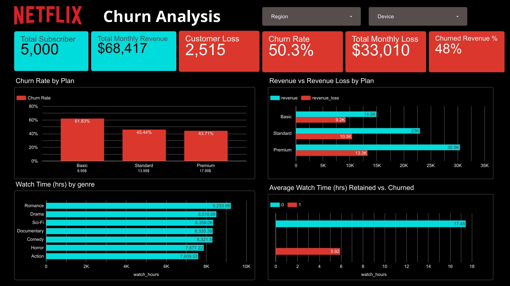

# Netflix Customer Churn Analysis

> SQL-driven analysis of a 5,000-user sample to find **who cancels, why, and what it costs**, with recommendations to improve retention.


[](https://datastudio.google.com/s/vG4OaIyEX54)

## Table of Contents
- [About This Project](#about-this-project)
- [Data and Scope](#data-and-scope)
- [Analysis and Findings](#analysis-and-findings)
- [Key Findings](#key-findings)
- [Recommendations](#recommendations)
- [Tools](#tools)

---

## About This Project

Subscription streaming lives or dies on retention. This project analyzes a 5,000-user sample of the Netflix Customer Churn dataset to answer four business questions:

1. Which subscription plans have the highest churn?
2. How does engagement (watch hours) differ between churned and retained users?
3. How much monthly recurring revenue (MRR) is lost to churn, and which plan drives most of it?
4. Which genres drive the most viewing, and where should content investment go?

**Headline results**

| Metric | Value |
| --- | --- |
| Users analyzed | 5,000 |
| Churned users | 2,515 (50.3%) |
| Lost MRR | $33,009.85 / month (48.25% of potential revenue) |
| Annualized loss | ~$396,118 |
| Avg. watch hours (retained vs. churned) | 17.45 vs. 5.92 |

---

## Data and Scope

Sample of 5,000 users from the Netflix Customer Churn dataset.

**Columns:** `customer_id`, `age`, `gender`, `subscription_type`, `watch_hours`, `last_login_days`, `region`, `device`, `monthly_fee`, `churned`, `payment_method`, `number_of_profiles`, `avg_watch_time_per_day`, `favorite_genre`

**Definitions**
- Subscription type: Basic = $8.99, Standard = $13.99, Premium = $17.99
- Churn: `1` = cancelled subscription, `0` = active

---

## Analysis and Findings

### 1. Churn rate by plan

```sql
SELECT
  subscription_type,
  SUM(churned)                          AS churned_customers,
  COUNT(*)                              AS total_customers,
  ROUND(SUM(churned) * 100.0 / COUNT(*), 2) AS churn_rate_pct
FROM netflix_churn
GROUP BY subscription_type
ORDER BY churn_rate_pct DESC;
```

| subscription_type | churned | total_customers | churn_rate |
| --- | --- | --- | --- |
| Basic | 1,027 | 1,661 | 61.83% |
| Standard | 748 | 1,646 | 45.44% |
| Premium | 740 | 1,693 | 43.71% |

**Insight:** Basic users churn at the highest rate, so the cheapest plan is the least sticky.

### 2. Average watch time: churned vs. retained

```sql
SELECT
  churned,
  COUNT(*)                     AS n_customers,
  ROUND(SUM(watch_hours), 2)   AS total_watch_hours,
  ROUND(AVG(watch_hours), 2)   AS avg_watch_hours
FROM netflix_churn
GROUP BY churned;
```

| churned | n_customers | total_watch_hours | avg_watch_hours |
| --- | --- | --- | --- |
| 0 | 2,485 | 43,362.23 | 17.45 |
| 1 | 2,515 | 14,885.02 | 5.92 |

**Insight:** Churned users aren't non-viewers. They try the service, finish what they came for (or fail to find something new), and cancel. If a new user can be pushed past roughly 17 hours of early viewing, the churn risk drops sharply.

### 3. Watch time vs. churn (engagement loss)

```sql
SELECT
  CASE
    WHEN watch_hours < 1 THEN '1. 0-1 hrs'
    WHEN watch_hours < 2 THEN '2. 1-2 hrs'
    WHEN watch_hours < 3 THEN '3. 2-3 hrs'
    WHEN watch_hours < 4 THEN '4. 3-4 hrs'
    WHEN watch_hours < 5 THEN '5. 4-5 hrs'
    ELSE '6. 5+ hrs'
  END AS watch_bucket,
  churned,
  COUNT(*) AS n_customers
FROM netflix_churn
GROUP BY watch_bucket, churned
ORDER BY watch_bucket, churned;
```

Share of users in each bucket:

| churned | 0-1 hr | 1-2 hr | 2-3 hr | 3-4 hr | 4-5 hr | 5+ hr |
| --- | --- | --- | --- | --- | --- | --- |
| 0 (retained) | 14.18% | 18.95% | 16.23% | 21.27% | 21.15% | 70.27% |
| 1 (churned) | 85.82% | 81.05% | 83.77% | 78.73% | 78.85% | 29.73% |

**Insight:** About 86% of users with under 1 hour of watch time churned. Low engagement is the strongest churn signal in this dataset.

### 4. ARPU (Average Revenue Per User)

```sql
SELECT
  churned,
  subscription_type,
  COUNT(customer_id)           AS n_customers,
  ROUND(SUM(monthly_fee), 2)   AS total_monthly_fee,
  ROUND(AVG(monthly_fee), 2)   AS avg_monthly_fee
FROM netflix_churn
GROUP BY churned, subscription_type
ORDER BY churned, avg_monthly_fee DESC;
```

| churned | subscription_type | n_customers | SUM monthly_fee | AVG monthly_fee |
| --- | --- | --- | --- | --- |
| 0 | Premium | 953 | 17,144 | $17.99 |
| 0 | Standard | 898 | 12,563 | $13.99 |
| 0 | Basic | 634 | 5,700 | $8.99 |
| **0 total** | | **2,485** | **35,407** | **$14.25** |
| 1 | Premium | 740 | 13,313 | $17.99 |
| 1 | Standard | 748 | 10,465 | $13.99 |
| 1 | Basic | 1,027 | 9,233 | $8.99 |
| **1 total** | | **2,515** | **33,010** | **$13.13** |

### 5. Top genres by watch time

```sql
SELECT
  favorite_genre,
  ROUND(SUM(watch_hours), 2) AS total_watch_hours
FROM netflix_churn
GROUP BY favorite_genre
ORDER BY total_watch_hours DESC;
```

| favorite_genre | total_watch_hours |
| --- | --- |
| Romance | 9,233.88 |
| Drama | 8,510.68 |
| Sci-Fi | 8,359.06 |
| Documentary | 8,335.39 |
| Comedy | 8,321.50 |
| Horror | 7,877.22 |
| Action | 7,609.52 |

**Insight:** Romance and Drama lead in viewing hours, making them the strongest candidates for catalog expansion.

---

## Key Findings

- **Revenue at risk is large.** Of $68,417 potential MRR per month, **$33,009.85 (48.25%)** is lost to churn, about **$396,118 per year**.
- **Premium causes the biggest financial damage** at $13,312.60 lost MRR per month, since each churned Premium user is worth the most.
- **Basic has the biggest volume problem**, with a 61.83% churn rate.
- **Churn is engagement-driven.** Churned users average 5.92 watch hours vs. 17.45 for retained users, and the first hours of viewing matter most.

---

## Recommendations

| Pain point | Recommended action |
| --- | --- |
| Basic churn is 61.83%, with little reason to stay | **Upsell / cross-sell campaign** moving Basic users to Standard |
| Premium churn costs the most revenue ($13,312.60/month) | Send **exclusive content or perks** to at-risk Premium users before they cancel |
| Early churn: users finish what they came for (~5.92 hrs) and leave | Push new users toward **~17 hours** of viewing through personalized recommendations and episodic or part-release content |
| Engagement drops after a main series ends | Expand the **Romance** and **Drama** catalog, the top drivers of watch hours |

> **Note:** The 17-hour threshold is a correlation, not proof that more viewing prevents churn. It should be validated with an A/B experiment before being treated as a causal target.

---

## Tools

- SQL
- Looker Studio

## Repository Structure

```
.
├── README.md
└── netflix_report-1.jpg
```
